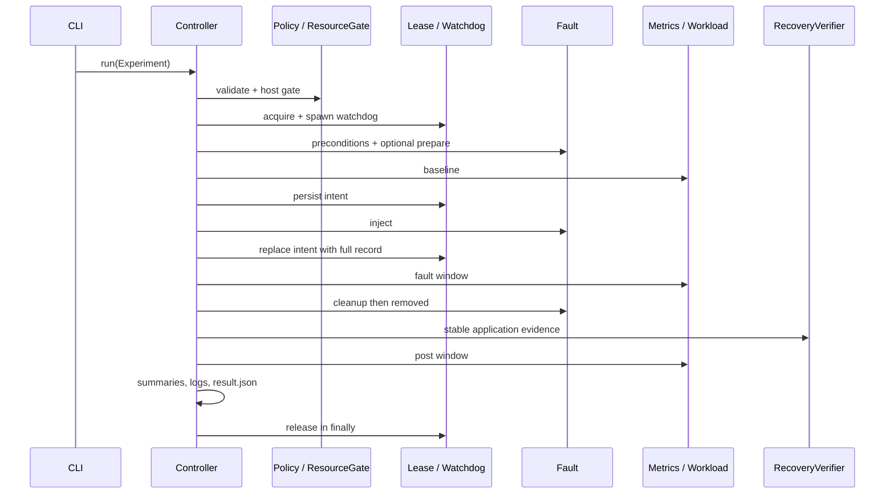

# Source-level execution flows

Read with [PROJECT_AUDIT.md](PROJECT_AUDIT.md). Paths are relative to the lab repository unless prefixed `factorysemantics-mes/`. These are source traces; live verification is explicitly recorded in the audit. Original requirement documents are unavailable.

## 1. Setup and persistent plant

```text
scripts/setup.sh → scripts/common.sh
  → read UPSTREAM_COMMIT, clone/pin FactorySemantics
  → Python .venv, requirements-lab.txt, editable upstream install
  → CLI cmd_prepare → Lifecycle.prepare
     → copy pack excluding generated out/ and caches
     → fsmes sim-generate → runtime/fleet/packs/bottling/out
     → fleet.toml → adapter.initialise → fsmes plant bottling init
  → cmd_check → Lifecycle.prerequisites
scripts/start.sh → cmd_start → Lifecycle.start
  → ResourceGate.check; require initialized DB and no detected components
  → FactorySemanticsAdapter.start → _run_fsmes
  → fsmes plant bottling start (upstream plant.start)
  → OPC replay, OPC agent, API, floor, log sink
  → wait_healthy → optional start_exporter
```

The adapter supplies `FSMES_PLANT_REGISTRY`, absolute configuration paths, process-name `PYTHONPATH`, and `CHAOSLAB_DB_HOOK_*`. `plant_environment` derives restart settings from the same fleet/pack. `spawn_component` launches a detached component and updates the `.pids` file. Logs go to files so detached children do not hold a caller's pipe open. Runtime pack/database/results are retained; live PIDs are not reusable snapshot state.

## 2. Direct infrastructure experiment



1. `scripts/run-experiment.sh` calls `python -m chaoslab --root ROOT run FILE`. `__main__`/`cli.main` dispatch to `cmd_run`; `model.load_file/from_mapping` checks schema.
2. `Controller.run` creates a unique result directory, provisional result, `StateTracker`, audit `submitted`, then state `preflight`. `PolicyValidator.validate` normalizes steps and estimates duration; host gate samples resources.
3. Dry run ends here with `overall_result: dry_run_ok` and terminal state `rejected`. It does **not** check live health, fault-specific prerequisites, scopes or hook availability.
4. Real run acquires lease, spawns an ID-bound watchdog, and enters `_run_infrastructure`. API must report status ok, every machine connected, all components alive, plant RSS below ceiling; each fault checks its prerequisites. Resource-limit preparation can restart into a scope before baseline.
5. Start `Sampler` and `WorkloadGenerator`, set baseline phase, wait with 250 ms stop-flag checks, and retain maximum baseline tag ID.
6. For each normalized step: bounded hold; persist `fault.intent`; inject; record result or exception; replace intent with actual record; mark fault phase. No user-supplied shell command executes.
7. After hold, `cleanup_records` invokes cleanup and an independent removal check. It runs records in reverse order. A failed injection still attempts intent cleanup. Cleanup failure stops further steps.
8. Between compound steps, verify recovery before next injection. Final recovery requires three consecutive core-success samples and data checks. Database/resource-specific restoration adds stages. A post window is sampled after successful recovery.
9. Stop threads; write per-second samples; phase summaries; orders before/after, OEE snapshot, logs, final health. `_finish` publishes result and audit. `finally` releases the lease. See audit for failure-record retention and incomplete-compound risks.

## 3. API outage and recovery

Definition: `experiments/definitions/api-process-outage-10s.yaml`.

```text
ProcessOutage.preconditions → _component_precondition
intent record → ProcessOutage.inject
  → adapter.kill_component('api', SIGKILL)
  → wait process absent/zombie; keep other components running
controller hold → cleanup_records
  → ProcessOutage.cleanup → adapter.spawn_component('api') if absent
  → ProcessOutage.removed → detected API process alive
RecoveryVerifier.wait
  → process/API availability
  → authenticated work-order summary
  → connected machines + recent floor check + advancing tag IDs
  → SQLite quick_check + nondecreasing baseline ID
```

This is a controlled OS process crash, not an exception thrown from an API route, a restart of the whole host, or a Docker kill. API reads fail while down; ingestion may continue through OPC agent. Recovery time is measured after cleanup, not from the initial signal. CLI/API execution has no `Agent` approval prompt; the agent path below does.

## 4. MCP asynchronous execution

`cli.cmd_mcp → mcp_server.main → build_server(root).run('stdio')`. MCP transports structured tool requests/results. Tools wrap expected exceptions as `ToolError`; safety remains in controller/policy.

`run_experiment` requires exactly one of `name` or `definition`. A name resolves through `LabApi.get_experiment`; a real run calls `LabApi.submit`. Submit schema/policy/lease checks, writes `runtime/state/submissions/<id>.yaml`, spawns `python -m chaoslab ... execute --run-id ...`, logs stdout/stderr to a file, and returns accepted plus ID. `execute_prepared` loads the saved definition and calls controller, which revalidates and acquires its own lease. Accepted means queued/launched, not passed or even injected.

`experiment_status` reads completed result or active lease; the asynchronous spawn-to-lease window can temporarily report unknown. `wait_for_experiment` polls every two seconds and caps waits at 900 seconds. Timeout leaves the experiment running. Result tools retrieve metrics/logs/scoring/recovery/compare from disk.

## 5. Agent loop and approval

```text
cmd_agent → commands.inject/analyze → _agent
  → build_server → ToolBox filtered role specs
  → LLMConfig.from_env → ChatClient
Agent.run (at most 16 rounds)
  → chat(messages, specs) → Reply / ToolCall
  → _dispatch: parse JSON object → role allowlist
     → real run_experiment? call approver first
     → ToolBox.call → in-process MCP tools → LabApi/controller
  → add tool result to messages + transcript → next model round
  → no tool calls: extract_json → AgentRun → save_transcript
```

`ask_terminal` uses `/dev/tty`, accepts y/yes only, defaults no, refuses if no terminal. CLI `--approve` selects `approve_all`. Injector prompt requests discovery, health/resources, validation, dry run, approved real run, and bounded waits; enforcement guarantees role membership and approval, not the whole procedural order. Analyst tools are read-only; `commands.analyze` writes a separate analysis file and checks whether a claimed baseline was present in actual compare calls. The deterministic controller result is preserved.

## 6. Database latency

Startup `with_database_hook → sitecustomize → install_from_environment → install` registers SQLAlchemy engine listeners only in configured commands. `Hook._matches` restricts to the exact real SQLite path. Runtime stats exist even while dormant.

`DatabaseLatency.preconditions` checks live clients have matching hook stats and no activation. `inject → write_control` atomically publishes token/plant/database/boot/monotonic deadline/delay. `before_cursor_execute` checks activation, sleeps and starts timing; `after_cursor_execute`/`handle_error` record observed/native/injected timings and histogram counters. A flusher publishes per-PID snapshots. Expiry is evaluated locally; a stale activation does not mean an endless delay.

Cleanup removes activation; `removed` waits for a sleeping statement and two stat-flush windows, then requires no increased injected count. Controller collects direct evidence separately from API effects. It delays SQL cursor statements, not network packets, direct sqlite3, or all commit/rollback operations.

## 7. Resource cap

`ResourceLimit.preconditions → cgroups.available`; `prepare` moves component into derived user-systemd scope and waits healthy before baseline. `inject` starts `holders.resource_reset` first, saves original limits, writes `memory.high`/`memory.max`/`memory.swap.max` and/or `cpu.max`, then records counters. `cleanup` stops helper, restores limits, restarts OOM-killed component; `removed` requires live component, restored files, dead helper. No host-level cap or arbitrary path is accepted. This path is unavailable on the audited cloud host without a user systemd manager.

## 8. Application simulation and scoring

`Controller._run_application` converts simulator steps through `SimulatorFault.event`, generates TOML with `ScoringAdapter.build_plan`, and adds latency measurement if needed to enable watched-state evidence. `ScoringAdapter.run` clears persistent fleet registry from its environment and calls `fsmes lab run` using a new per-run results directory and fixed ephemeral ports. It polls stop/timeout and terminates its process group when required. Host sampling is separate from live-plant sampling.

After harness exits, terminate detected leftovers; load current scores and watched states; `derive/state_timeline` summarize booking bands, downtime, OEE, connection/state windows. `_application_recovery` checks teardown, score-producing service, answered operations, post-event states and data accuracy. Missing post-window looks prevents observable recovery. Duration is null because replay line time differs from wall time. Persistent-plant recovery stages are not reused as if this were infrastructure.

## 9. Watchdog and emergency stop

`watchdog.spawn` starts detached module with root and experiment ID. `run` polls lease: released/missing/different ID exits; dead controller/expired deadline calls shared cleanup, updates released state and audits. It does not restart the machine or kill the overdue controller.

`LabApi.emergency_stop`: write flag, wait up to 20 seconds, clean remaining records if necessary, then sweep stopped plant components, recognized holder processes, latency activation and lab scopes. It cannot reconstruct every lost record or resurrect an unrecorded missing component. Self-limiting helpers independently expire.

## 10. Observability and persistence

`MetricsAdapter.sample → MES health + authenticated summary/states + /metrics + process_table + DB-hook/cgroup/host snapshots → Sampler → phase summaries + samples.jsonl`. `RecoveryVerifier` uses these same observations. `LogCollector.collect` filters UTC window, redacts recognized secret patterns, retains bounded important/info excerpts.

Exporter `Collector.render` caches a scrape for one second; `_build` reads adapter, lease and latest `ResultStore`; `make_handler` serves metrics and exporter healthz. Prometheus scrapes exporter every five seconds and MES every ten; Grafana provisioned JSON queries Prometheus. Neither changes controller results. `ResultStore.write_result` uses temporary file replacement; `flatten/compare` generate CSV/deltas and preserve missing values.

## 11. Generic backend RAG

```text
uvicorn/gunicorn app.main:app
  → apply_os_limits before numerical libraries
  → FastAPI + CORS/timing/memory middleware → register_rag
upload → upload_document → DocumentLoader.ingest
  → parser → LangChain splitter → lazy CPU embedding
  → locked/reloaded FaissStore + durable source upload + immutable snapshot
retrieve → Retriever.retrieve → query vector → cosine top-k/filter/threshold
query → RAGPipeline.query → LangGraph
  → retrieve → optional rerank → bounded context
  → included context? generate + citation validation : insufficient evidence
```

Generation configuration is checked **before** graph execution, including the empty-context path. `/retrieve` needs no hosted LLM key; real first embeddings may need model download. Query includes only actual context source IDs and rejects unknown/absent citations. `FaissStore.transaction` serializes readers/writers across processes; `_save` fsyncs a generation then atomically publishes CURRENT. Offline `rebuild` verifies uploads, stages a new index and keeps a backup. This flow does not feed the chaos agents or recommend changes to the MES.

## 12. Docker alternative

Upstream Compose: PostgreSQL health → one-shot migrate/init/seed → API replicas; nginx proxy waits for healthy API; OPC simulator starts; OPC agent and ERP sync wait for migrations and their peer services. Docker DNS resolves service names, nginx re-resolves API; named volume retains PostgreSQL. Native lab controller has no Docker adapter/socket and cannot use its process discovery or SQLite faults unchanged against this topology.
